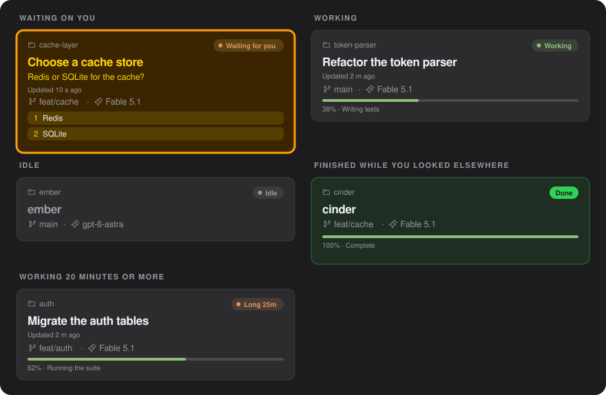
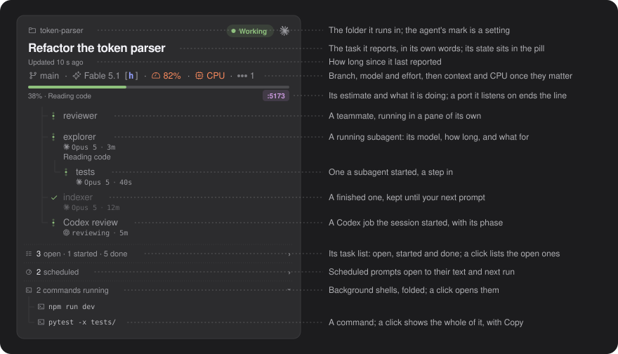
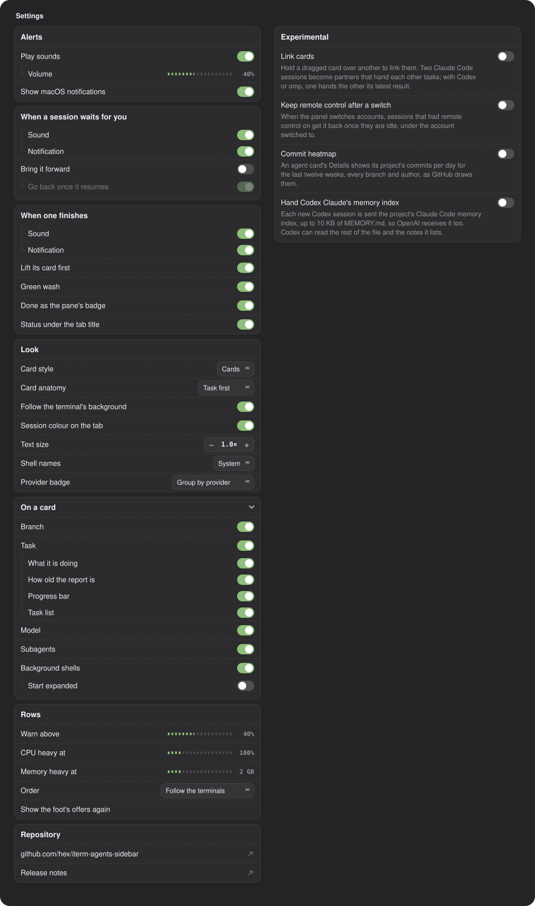
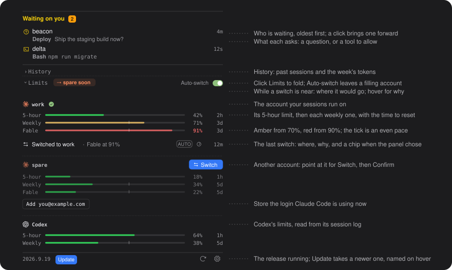
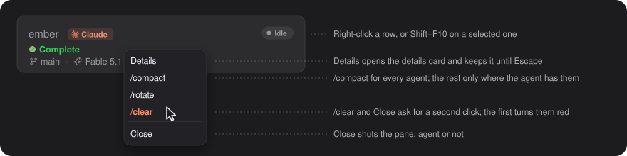

# Agents sidebar

A tool for the iTerm2 Toolbelt that lists every terminal session in every
window and tab, with the Claude Code, Codex and omp ones at the top, each showing what it's doing and whether it needs you. Click a row to focus that session.

## Install

```sh
curl -fsSL https://raw.githubusercontent.com/hex/iterm-agents-sidebar/main/get.sh | bash
```

That clones the repository to `~/.local/share/agents-sidebar/src` and runs
`install.sh` there. The bar at the foot names the release you run and, once
a newer one is out, offers it with an Update button. Running the same line
again on an installed machine stops with a pointer to that button. Or clone it anywhere yourself and run `./install.sh`: the
clone is the install, so leave it in place; the Update button updates it too. It needs nothing else: one iTerm2 Basic
script, no pip, no virtualenv, nothing beyond the standard library.

The install starts the daemon when iTerm2 is running. If a daemon already
runs, it leaves it alone and prints its restart command. If iTerm2 isn't running,
open it and choose Scripts > AutoLaunch > `agents_sidebar` to start the panel.
A launch failure prints iTerm2's error and leaves the install in place.
View > Toolbelt > Agents opens the panel.

The install also points `statusLine.command` in `~/.claude/settings.json` at
`plugin/statusline-bridge.sh`, because that payload is the only place Claude
Code says how full the context is; the bridge publishes it and then renders
the statusline you had, so your line stays. The install backs the file up first.
If that command exits 127, the bridge shows `status line: <command or script> not found`
instead of keeping stale text. Other failures keep the last rendered line.
Without it, cards show no context %, model or effort, and the details card no cost,
limits or cache. Whenever `settings.json` lacks the bridge (installed with
`--no-statusline`, or replaced by another tool), the foot of the panel says so
and offers Install, which does the same step, or Not now; Settings > Rows >
Show the foot's offers again brings dismissed offers back.

If Codex CLI is on the machine, the install also adds the state hook to
`~/.codex/hooks.json`, keeping whatever other tools put there, and names a
writable directory in `~/.codex/config.toml`; Codex asks once to trust the
hook. Without Codex, nothing of that happens.

If omp is on the machine (on your `PATH`, or `~/.omp/agent` exists), the install
also writes `agents-sidebar.ts` into omp's extensions directory, so omp
sessions report their turns through the same hook. It never replaces a file
of that name it did not write.

```sh
./install.sh --no-statusline   # leave settings.json alone; cards show no context figure
./install.sh --no-codex        # leave Codex's files alone
./install.sh --codex           # insist, and fail if Codex is not there
./install.sh --no-omp          # leave omp's directory alone
./install.sh --omp             # insist: fail if omp is not there or its extension cannot be written
```

Through the one-liner, a flag goes after `bash -s --`. See
[docs/integrations.md](docs/integrations.md) for the detail and how to undo
any of it. Run `agents-sidebar uninstall`, or choose **Uninstall the panel…**
at the bottom of Settings and confirm. Both remove the script, the hook,
our entries from Codex's hooks, the omp extension,
the notifier, the `agents-sidebar` command, the panel's own `apiKeyHelper` in
`~/.claude/settings.json` (another tool's stays, and uninstall says so), and the
panel's settings, state and account store with the Keychain items
behind it, the account logins and API keys, by default. To keep saved logins, turn on **Keep my account logins**
in the confirmation, or run `agents-sidebar uninstall --keep-accounts`.
This keeps `~/.config/agents-sidebar/accounts.json` and its Keychain items;
the other panel data still goes. It leaves the checkout, the `.before-agents-sidebar` backups and
the writable directory line in `~/.codex/config.toml`. The command prints a
quoted command to delete the checkout. Settings shows the uninstall log's path.
Uninstall restores your saved statusline unless its absolute script path is
missing; then it removes `statusLine` and warns with that path. You can also
run `./uninstall.sh` from the checkout, with `--keep-accounts` to keep logins.

Notifications need `swiftc`, from the Xcode Command Line Tools
(`xcode-select --install`). Without it the panel works as usual and posts
nothing. With it, `install.sh` builds
`~/.local/share/agents-sidebar/Agents.app`, macOS asks once to allow its
notifications, and the app gets its own entry in System Settings where you set
its sound and banner style.

## Using it

| Key | What it does |
| --- | --- |
| Down | Move to the next session |
| Up | Move to the previous session |
| Enter or Space | Focus the selected session |
| Cmd+Enter or Ctrl+Enter | Send a newline, to unblock an agent sitting at a prompt |

Click an empty part of the panel first to give it keyboard focus. Arrow keys
only; iTerm2 keeps the other combinations for itself.

A card that starts waiting on you, or asks something new while it waits, scrolls into
view when it sits out of sight; so does a card whose row under "Waiting on you" you click.

### What a card says



| State | How it looks |
| --- | --- |
| Waiting on you | The whole card amber, with a `Waiting for you` pill (`Waiting` under Name first) and what it asks: the question with a button per answer (a question that takes more than one answer gets a box per option and a Submit button), or the reason it gave, the tool and the command it wants to run, with Yes and No. A token, key or password in a command shows as `***`, on the card and in its notice |
| Working | A green `Working` pill, the task as the title, and how long since it reported |
| Idle | A grey `Idle` pill, the title in grey |
| Finished while you looked elsewhere | The whole card washed green with a Done badge in place of Idle, lifted under any waiting card, and the word Done as iTerm2's badge in its pane, until you look at that session |
| Working 20 minutes or more | A warm `Long 25m` pill, in case it has stalled |
| Exited | Faded, with an `Exited` pill and a Resume button: the agent's process died and the pane is back at its shell prompt |
| Unknown | A grey `No report` pill: a turn silent for five minutes with no command or tool running under it |

A conversation that is over and gone from the list is under **History** above the limits, on its Sessions tab: the last week's, with Resume in a new tab ([usage](docs/usage.md#sessions)).
What the agents did this week is on History's Activity tab: prompts and tokens a day, and the projects that used the most, from Claude Code's and Codex's own logs ([usage](docs/usage.md#activity)). History opens on the tab it showed last ([usage](docs/usage.md#history)).
A server a session runs shows on its card as a port pill, `:5173`, at the end of its report line, or of the line with its branch and model when the card reports nothing. The pill takes the colour of its server's language: violet for JavaScript (`node`, `bun` or `deno`), blue for Python, red for Ruby and grey for anything else. One grey `+N` pill stands for the rest. The pill opens each one's program, uptime and address, with Open and Stop ([usage](docs/usage.md#ports)).
In the list the pill opens, an amber globe marks an address the network can reach. A card waiting on you hides its pill while it shows its answers or Yes and No, and the pill comes back once you answer. Under about 300 px, Open and Stop show only their icons.



Card anatomy in Settings > Look offers Task first, with the folder, state
pill, active task title and update age, or Name first; new installs use Task
first, while saved settings keep Name first until changed.

Serenity, in Settings > Look, leaves the branch and the subagent, task,
scheduled-prompt and shell lists off the card at full width, and Details shows
them instead. A compact Serenity card has the usual compact Details.

With Name first, an agent reports its own task under the name: a title, then
`Reading code · 40s`, then ticks for how far it says it has got. The
percentage is the model's estimate, not a measurement, so a report older than
five minutes puts `Last:` before what it said with its age, and a finished
one reads `Complete`. The ticks show only while the session works on a fresh
report. A session at rest whose last words were `Waiting for you` says so in
the warning colour: no prompt is open, so the card stays Idle, but the next
move is yours. The compact card draws no activity line on an idle card, so
there the words do not show.

The line below carries the branch, shortened from its front so the last part
stays readable, the model with its effort letter (`[l]`,
`[m]`, `[h]`, `[xh]`, `[mx]`), the context percentage, and a `CPU` or `Mem`
chip when the session's process tree is using a lot of the machine. While a
chip shows, the details card adds a `CPU` or `Memory` row with the figure and the
name of the program using the most of it. Details in a Claude card's right-click
menu opens a card with the session's colour, name, state and model, its
gauges, chips for effort, thinking, fast mode and `past 200k`, and one row of
counts: Up, Agents, Cost and Lines. Every row says on hover what its figure
means (Lines gives the exact counts past 1,000). It also offers Context breakdown, `/context` for that session
drawn as a bar ([usage](docs/usage.md#what-fills-the-context)). A Codex
card wears the OpenAI mark instead of the Claude one, and has no teammates and
no background-shell line. Codex opens its session at your first prompt, so
until then its card shows the name, the branch and a `Codex` mark, and no
state. Once Codex titles the conversation, the title its status line shows
sits under the card's name, in place of the title of any task it reports.
A Claude card whose session has Remote Control on shows a small grey
broadcast glyph after its name ([usage](docs/usage.md#remote-control)).
In a narrow panel, or at a large text size, an agent card shows its name
and its state, and the foot is one line ([usage](docs/usage.md#a-narrow-panel)).
The panel takes the background colour of the pane in front and draws its cards
in shades of it, light or dark as that colour is ([usage](docs/usage.md#the-terminals-background)).
Each agent's tab says the same under its title: `working`, `needs you` with
the question, `done`, or `idle`, in the panel's colours ([usage](docs/usage.md#the-status-under-a-tab)).
A cs session's tab takes a tint of the session's colour, 35% of it over the
pane's background, on by default. iTerm2 colours a tab from its active pane,
and a pane with a tab colour of its own keeps it
([usage](docs/usage.md#the-sessions-colour-on-its-tab)).

An omp session reports its state through the extension the install writes:
when a turn starts and ends, when an approval or a question waits on you, and
when the session ends. Without the extension the panel reads omp's tab title
instead: `π >` at your turn, `π !` while an approval or a question waits, and a
spinner while it works. Either way it takes the rest from omp's own
files under `~/.omp`: the model, the effort, the context figure and what the
session has cost. The name omp gave the session sits under the card's name, and
while omp works, what it says the running tool is for sits under that. Commands
omp sent to the background show as running commands do on a Claude Code card.
Subagents omp spawns with its `task` tool get a row each, under the name omp
gave them, with their model, context, spend, how long they have run and,
while they run, what their running tool is for. A finished one keeps its row
until your next prompt. The card has no task line. With the extension, a
waiting approval shows its tool and the start of its command, and a question
its text and options; you answer both in omp, so the card has no buttons for
them. From the title alone, a wait shows as blocked without its text, and
inside plain tmux the title never reaches iTerm2, so the row stays a plain
terminal. omp posts its own notifications, so the panel adds none for it.

Teammates nest inside the card, and while one of them is working the lead's
line carries the busy dots and a count, since a teammate runs in its own pane
and the lead's own badge stays about the lead. Running subagents get a row each, with the
model they reply with (until the first reply, the one they asked for) and how
long they have run. A subagent started by another
subagent sits one step in, under the one that started it. A Codex job started
through the codex plugin (a rescue or a review) gets a row too, with its phase.
A finished subagent keeps its row until your next prompt, and one still
running in the background stays through it. Past three of them,
they fold into one line ("30 finished") that opens on a click, and the ones
still running stay in sight.
A session's open tasks, the checklist it keeps
with TaskCreate or the open steps of a Codex plan, fold into one line
("27 open · 11 started · 40 done") that opens to the open items only.
Started tasks come first, each with a half-filled circle and what the session is doing on it; pending ones
follow with an empty ring. Codex plans have
no done count, so their head reads "6 tasks · 1 started".
Prompts a Claude session has scheduled with `/loop`, CronCreate or
ScheduleWakeup fold into the next line ("2 scheduled"), a row each with
when it runs: "every 10 min", "daily at 09:00", "once at 13:31". Claude Code
lists them when the session's turn ends, so a one-shot that has fired reads
"due" until then, and a resumed session can show its old list until its
first turn ends.
Background shells fold into
one line ("2 commands running") that opens on a click; a row shows a long
path by its last part, and clicking a shell shows the whole command with a
Copy button.

### Sessions on another machine

A pane that runs `ssh` or `et` (Eternal Terminal) to a machine with the hooks
installed gets a card for the Claude Code session there: its state, the host
it runs on, its folder, and a question you can answer from the card. Answer
a question whose options show previews in its pane, since picking there
takes Enter. A row
under the Accounts head then names each machine the panes reach, with its
agent count and whether a pane here holds its connection. Model, context,
tasks and replies wait for a later release. See
[docs/usage.md](docs/usage.md#sessions-on-another-machine).

### Answering from a banner

The banner can answer for you, so a session in another tab doesn't wait.

| On the banner | What it does |
| --- | --- |
| A click | Brings that session forward, tab and all. A hidden hotkey window gets its profile's hotkey first |
| A question's option button | Sends that option's number into the prompt, and Enter after it when the options show previews. A question that takes more than one answer gets no buttons and no Other |
| Other | Picks that option, then types your text. A question whose options show previews has no Other, so its banner has no reply field |
| Allow, on a permission gate | Answers Yes. It shows the command's first line and approves the whole command, so No stays in the terminal |
| Reply, on a finished turn | Your text becomes the session's next prompt. The panel types nothing if the session has since started waiting on you, its agent has exited, or another program is in front of its agent |

### Settings



The gear opens the drawer. On a card starts folded and remembers whether you
open it; the figure shows it expanded. Sound and notification options hide
while their switches in Alerts are off. Other indented settings hide while
the switch above them is off. The figure also draws the options the defaults
hide, greyed, and Show the foot's offers again, which shows only while an
offer stays dismissed.

| Card | Settings |
| --- | --- |
| Alerts | Play sounds, Volume, Show macOS notifications |
| When a session waits for you | Sound, Notification, Bring it forward; under it Go back once it resumes |
| When one finishes | Sound, Notification, Lift its card first, Green wash, Done as the pane's badge, Status under the tab title: see [The status under a tab](docs/usage.md#the-status-under-a-tab) |
| Look | Card style, Card anatomy, Follow the terminal's background, Session colour on the tab, Text size, Shell names, Provider badge: see [Card style](docs/usage.md#card-style) and [The session's colour on its tab](docs/usage.md#the-sessions-colour-on-its-tab) |
| On a card | Branch, Task (under it What it is doing, How old the report is (Name first), Progress bar, Task list), Model, Subagents, Background shells (under it Start expanded) |
| Rows | Warn above, CPU heavy at, Memory heavy at, Order, Show the foot's offers again (while an offer stays dismissed) |
| Experimental | Link cards, Keep remote control after a switch, Commit heatmap and Hand Codex Claude's memory index, each off until you turn it on: see [Linking two sessions](docs/usage.md#linking-two-sessions), [Remote control](docs/usage.md#remote-control), [Commit heatmap](docs/usage.md#commit-heatmap) and [Claude's memory index in Codex](docs/usage.md#claudes-memory-index-in-codex) |
| Accounts | When every account is full, use API credits, and per account its API key and that key's Cap: see [API credits](docs/usage.md#api-credits) |
| Repository | Nothing to set: the GitHub repository the install updates from, and Release notes, each opening its page in your browser |

Some have limits the picture doesn't show:

| Setting | Range |
| --- | --- |
| Warn above, the context figure a row starts to show | 0 to 100% |
| CPU heavy at | 25 to 400%, of one core |
| Memory heavy at | 0.5 to 8 GB |
| Text size | Minus and plus buttons over nine sizes, 0.8 to 1.6 times the size as designed |



The foot lists the sessions waiting on you, oldest first, each with what it
asks: the question's header and text, or the tool and its command. Under them are
the History fold, then your Claude account limits:
5-hour, weekly, and per-model weekly, with the time left
until each resets. The tick on a weekly bar marks where an even spend across
the week would be right now; a percentage turns warm 15 points past it, and the
row's hover says both figures. Store a login with **Add <your email>** and you can switch
between accounts from there. Auto-switch, off by default, spends first the
quota that resets soonest and leaves an account before a limit stops your
sessions. Only the limits of the models your sessions run, or ran in the last
ten minutes, decide when to leave an account, and a model
limit full on every account stops counting, since no switch frees it. Leaving an
account near its limit, Auto-switch judges the account it moves to on every
model used in the last two hours.
While Auto-switch is on, you have two or more accounts and a switch is near,
a chip reads the account's name and `soon`, or `near 100%` when every other
account is over 90% too, and gives the reason on hover; [docs/accounts.md](docs/accounts.md#switching-on-its-own)
lists its other readings. With **When every account is full, use API credits** on in Settings, a key saved on an account
and the statusline bridge installed, the sessions
move to API credits when every account is full, or every model they run is full
on every account, and back at the first reading
that shows room, each move asked with a notice and **Not now** first. They use the
active account's key, or the next account's in list order, each key under a
soft spend cap of its own. A key at its cap, out of credits or refused hands
over to the next key at once, and with none left the sessions go back at once
([docs/accounts.md](docs/accounts.md#api-credits-when-every-account-is-full)).
Codex's own limits sit under them, read from
its session log: a 5-hour and a weekly window, or weekly alone, depending on
the plan, and a row for the fallback allowance while Codex draws on one, such
as Luna Reserve. A spent window stays at 100% until it resets, also while
Codex refuses every new session. Click **Accounts**, or its head outside Auto-switch and its
chip, to fold the lot to a tile per
account and Codex, each with its fullest window as one bar. An account's bar
passes over a model limit full on every account for the next limit with room,
and its hover says when that model returns. See [docs/accounts.md](docs/accounts.md).

The bar at the bottom names the release you run, and two buttons: reload and
the gear. Click the release to read the release notes on GitHub. A right-click on reload offers Rebuild the panel, which opens it afresh in every window, for a panel that stopped answering the pointer or stopped drawing. At start, once a day and on every reload press, the daemon lists
the releases on the repository it was cloned from; when one is
newer, the bar adds an Update button that names it in its tooltip. Pressing it takes that
release only if a release key the installed copy already trusts signed it,
then runs `install.sh` and restarts the daemon, after which the panel
needs reopening from View > Toolbelt. See
[docs/usage.md](docs/usage.md#updating).



Right-click an agent row, or press Shift+F10 on a selected one, for
Details, `/compact`, `/rotate`, `/clear` and Close. A card linked to a
partner also offers to ask its partner for a review, and Untie from its
partner. Details opens the row's
details card and keeps it open until Escape or a click elsewhere; nothing
else opens the card. Close and `/clear` ask for a second
click. The menu stays where it opened while the cards under it grow, shrink,
arrive or leave, and scrolling the list closes it. A Codex row gets Details, `/compact` and Close, since Codex has no `/rotate` or
`/clear`. An omp row gets Details, `/compact`, `/clear` and Close. A plain terminal's
row gets Close alone. A command is not typed while the session waits on you,
since the prompt would take it as your answer, after its agent has exited, or
while another program (an editor, or the shell of a suspended agent) is in
front of the agent. The card says why for a few seconds.

Drag an agent card up or down to put it there. The drop switches Order to By
hand, which keeps the cards where you put them; see
[docs/usage.md](docs/usage.md#order).

With Link cards on under Experimental in settings (it starts off), hold a
dragged card still over another agent card for 0.4 s and let go to link the
two sessions. Two Claude Code sessions become partners, one card on
the panel: each can read the other's recent conversation and hand it a task,
getting the answer back. Either card's menu also asks the other for a
read-only review of its session's change, and the findings come back to that
session as a prompt. They stay partners through `/clear` until you untie
them from either card's menu, drag one card out of the pair, or turn Link
cards off. With Codex or omp in the pair, the dragged card's session writes
up its latest result and the session under it starts working on it, with
nothing typed in either terminal; Codex and omp take their part with your next prompt
there. See [docs/usage.md](docs/usage.md#linking-two-sessions).

### From a script

The install links an `agents-sidebar` command into `~/.local/bin`, which
reads the running panel:

```sh
agents-sidebar status                          # session id, label, provider, state
agents-sidebar wait atlas                      # until atlas waits on you or is idle
agents-sidebar wait current --until done --timeout 600
```

`wait` exits 0 with the session's row as JSON once it reaches a state you
named, and 1 on a timeout, a closed session or no panel. See
[docs/usage.md](docs/usage.md#from-a-script) for the states and targets.

## What it reads, and where it goes

Everything stays on your Mac unless you store an account or turn on Hand Codex
Claude's memory index. The daemon reads:

- iTerm2, through its API: every session's title, working directory and
  foreground job, and the pane in front.
- What the hooks publish from Claude Code, Codex and omp: the state, the
  working directory, the tool names, the task line, the prompts a session has
  scheduled, and the question or the permission a session waits on. That
  text goes to the card, the macOS banner and the line under the tab. A
  token, key or password in a command or a scheduled prompt shows as `***`;
  free text in a question reads as the agent wrote it.
- The statusline payload: context, model, effort, cost and limits.
- The first 64 KB of each transcript under `~/.claude/projects`, for
  History's **Sessions** tab: the directory and the first prompt, nothing after.
- `ps`, for each session's process tree, and `git` in each session's
  directory, for its branch.
- `lsof`, every 5 seconds at most and again a second after a Stop, for the
  ports on the cards: each listening
  TCP socket's address, port and the pid and name of the process that holds
  it. For a listener outside every card's process tree, the kernel's copy of
  its environment, from which it keeps `CLAUDE_PID` alone.
- Claude Code's transcripts under `~/.claude/projects` and Codex's rollouts
  under `~/.codex/sessions`, when History shows its **Activity** tab: each line's time,
  directory and token counts, which lines are prompts, the client that wrote
  them, and a conversation's cost. It keeps none of the text.

It writes under `~/.claude/agents-sidebar-*`, `~/.config/agents-sidebar` and
`~/.local/share/agents-sidebar`, readable by your user alone; the list is in
[docs/development.md](docs/development.md#what-the-panel-keeps-on-disk).
An earlier release may have left `tab-underline.json`, its record of whether it
hid iTerm2's line under the selected tab. Where it did, the daemon puts that line
back once at its start, with `defaults write` or `defaults delete` on
`com.googlecode.iterm2`, unless you changed it since. Uninstall does the same
([docs/integrations.md](docs/integrations.md#uninstall)).
The daemon serves the panel on `127.0.0.1` behind a random token minted at
every start. It sends nothing anywhere, with four exceptions: the update
check fetches this repository from GitHub; `ssh` reaches the hosts your panes
already reach; once you store an account, the panel keeps that login's
refresh token in its own Keychain item and calls Anthropic's token and usage
endpoints with it, which [docs/accounts.md](docs/accounts.md#before-you-store-anything)
explains before you do; and once you save an API key on an account, the panel calls the
API's models list with it when you save it and before each move to credits or to that key.
While sessions run on credits, it also writes `apiKeyHelper` into
`~/.claude/settings.json`
([docs/integrations.md](docs/integrations.md#api-credits-and-settingsjson)).
The panel sends no telemetry.

Hand Codex Claude's memory index, under Experimental and off until you turn it
on, makes the Codex hook read the project's Claude Code memory index,
`MEMORY.md`, at the start of each Codex session. Codex gets up to 10 KB of it
and sends it to OpenAI with the rest of the session. It can also read the rest
of the file and the notes the index lists
([docs/usage.md](docs/usage.md#claudes-memory-index-in-codex)).

## More

- [docs/usage.md](docs/usage.md): what every part of a card means
- [docs/accounts.md](docs/accounts.md): accounts, switching, the meters
- [docs/integrations.md](docs/integrations.md): the statusline bridge, Codex hooks, the omp extension and linked cards, and how to opt out
- [docs/troubleshooting.md](docs/troubleshooting.md): `STALE`, `?`, a white panel,
  tracing the statusline bridge
- [docs/development.md](docs/development.md): how it works, tests, releases

The panel would rather show nothing than a believable wrong answer. Every row
dims behind a `STALE` banner when the list is no longer known to be true, and a
session iTerm2 can't report shows `?` rather than a guess.

## Licence

[MIT](LICENSE). The icons are others' work, credited in
[THIRD-PARTY-NOTICES](THIRD-PARTY-NOTICES).
